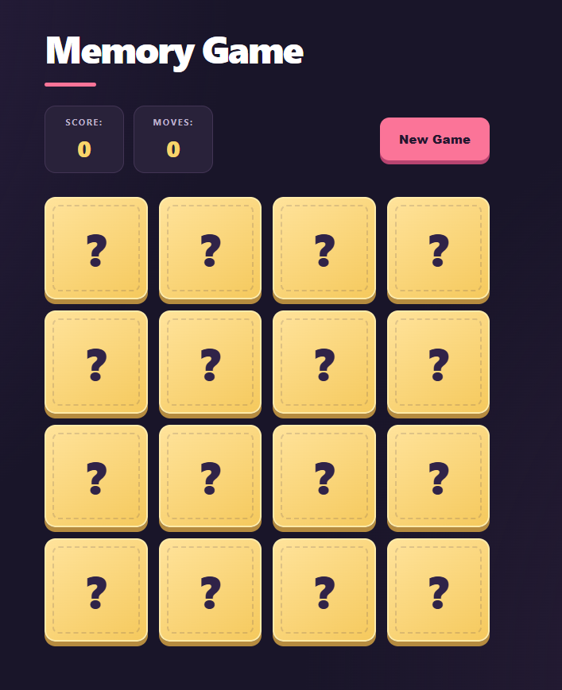

# Memory Cards Game

A browser-based memory matching game built with **React**, **JavaScript**, and **Vite**. Flip cards, remember the symbols, and match all eight pairs in as few moves as possible.

**[🎮 Play Memory Game](https://cyenara.github.io/Memory-game/)** · [Source code](https://github.com/cyenara/Memory-game)

> Live demo requires GitHub Pages to be enabled (Settings → Pages → Source: GitHub Actions).

## Features

- Randomized cards with matching logic
- Card flip animations and visual feedback
- Score and move tracking
- Game reset and win detection
- Responsive design

## Tech stack

- **React** — reusable UI components and state updates
- **JavaScript** — matching logic, shuffling and score tracking
- **CSS** — custom styling, animations and responsive layout
- **Vite** — development server and production build

Game logic is separated into a custom React hook, `src/hooks/useGameLogic.js`.

## Run locally

Requires Node.js and npm.

```bash
git clone https://github.com/cyenara/Memory-game.git
cd Memory-game
npm install
npm run dev
```

Open the local URL displayed in your terminal.

## How to play

1. Click a card to reveal its emoji.
2. Click a second card and try to find a matching pair.
3. A matched pair stays visible; unmatched cards flip back.
4. Find all 8 pairs to win. Your moves are counted every two-card attempt.
5. Press **New Game** to start again.

## Screenshot

(screenshot2.png)(screenshot3.png)

## About

A small portfolio project for practicing React components, custom hooks, state management, array shuffling, event handling and responsive design.
